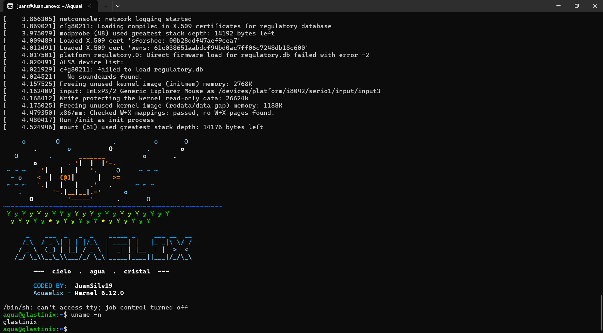

# Aquaelix

Distro Linux experimental hecha desde cero, con look de cristal, agua y cielo (Frutiger Aero).

Proyecto de aprendizaje: compilar el kernel de Linux, armar un sistema mínimo con BusyBox y arrancarlo en QEMU, para después construir encima un escritorio con estética Frutiger Aero.

## Estado actual

- [x] Kernel Linux 6.12 compilado con `defconfig`
- [x] BusyBox 1.36.1 compilado de forma estática
- [x] Initramfs con un script `init` propio
- [x] Primer arranque en QEMU con terminal
- [ ] Escritorio gráfico
- [ ] Estética Frutiger Aero
- [ ] ISO instalable

## Así se ve



El sistema se llama **Aquaelix**. El nombre del equipo y del prompt es `glastinix`: `aqua@glastinix`.


## Estructura del repo

| Carpeta | Contenido |
|---|---|
| `config/` | Configuración del kernel (`kernel.config`) y de BusyBox (`busybox.config`) |
| `initramfs/` | Script `init`, lo primero que ejecuta el kernel al arrancar |
| `scripts/` | Scripts para armar el initramfs y arrancar en QEMU |
| `docs/` | Notas del proyecto |

El código del kernel y de BusyBox **no** se sube al repo: se descargan en `linux/` y `build/`, que están en el `.gitignore`.

## Requisitos

- Ubuntu 24.04 (nativo o con WSL2)
- Unos 15 GB de espacio libre y varios minutos de compilación

```bash
sudo apt install -y build-essential flex bison libssl-dev libelf-dev bc qemu-system-x86 git wget cpio
```

## Cómo reproducirlo

### 1. Clonar el repo

```bash
git clone https://github.com/JuanSilv19/Aquaelix.git
cd Aquaelix
```

### 2. Compilar el kernel (unos 15 minutos con 8 núcleos)

```bash
git clone --depth 1 --branch v6.12 https://github.com/torvalds/linux.git
cd linux
make defconfig
make -j$(nproc)
cd ..
```

El resultado queda en `linux/arch/x86/boot/bzImage`.

### 3. Compilar BusyBox (estático)

```bash
mkdir -p build && cd build
wget https://busybox.net/downloads/busybox-1.36.1.tar.bz2
tar xf busybox-1.36.1.tar.bz2
cd busybox-1.36.1
make defconfig
sed -i 's/# CONFIG_STATIC is not set/CONFIG_STATIC=y/' .config
sed -i 's/CONFIG_TC=y/# CONFIG_TC is not set/' .config
make -j$(nproc)
make install
cd ../..
```

Se desactiva el módulo `tc` porque no compila con el Ubuntu 24.04.

### 4. Armar el initramfs

```bash
./scripts/build-initramfs.sh
```

Pide la contraseña de `sudo` para crear `/dev/console` y `/dev/null` dentro del `rootfs`.

### 5. Arrancar en QEMU

```bash
./scripts/run-qemu.sh
```

Debe aparecer el banner "Bienvenido a Aquaelix" y una shell. Para salir: `Ctrl + A`, soltar, y luego `X`. No escribir `exit`: esa shell es el proceso `init` y el kernel entraría en pánico.

## Notas

- Se desarrolló en WSL2, que no tiene KVM. QEMU funciona, pero más lento, y salen avisos de `clocksource` y `tsc` al arrancar. Son normales.
- Los avisos `regulatory.db` y `No soundcards found` también son normales: el mini sistema no tiene Wi-Fi ni sonido.

## Créditos

- [Linux kernel](https://github.com/torvalds/linux), licencia GPLv2
- [BusyBox](https://busybox.net), licencia GPLv2
